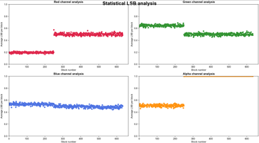
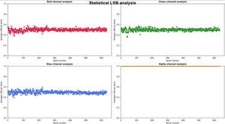

# Python-Anwendung zur Analyse von vermeintlich LSB-steganographierten Trägermedien.
Mit dieser Anwendung kann überprüft werden, ob auf einem Bild LSB-Steganographie durchgeführt wurde.

## Steganographie
Verbirgt die Existenz eines Payloads in einem Trägermedium. Das Trägermedium kann Bild-, Audio- oder Videodatei sein.

## LSB-Steganographie
Eine bestimmte Form der Steganographie. Hier werden die Least Significant Bits (LSB), also die letzten Bits der Kanäle (rot, grün, blau, alpha) benutzt bzw. ersetzt durch die Bits des Payloads. Dabei wird darauf abgezielt, dass das menschliche Auge die farbliche Änderung des LSB höchstwahrscheinlich nicht bemerkt.

## Vorgehen der Anwendung
Die Anwendung zerlegt das Trägermedium (Bild) in seine binären Bestandteile und extrahiert die LSBs pro Kanal und speichert sie in eine sparate Kanal-Liste. Diese Kanal-Listen werden in gleich große Blöcke zerteilt. Jeder Block ist 1.000 Bit groß. Pro Block wird der Mittelwert berechnet und diese Mittelwerte in je nach Kanal in eine weitere Liste gespeichert. In einem Scatter-Plot (dt. Streudiagramm) werden schließlich diese Blöcke durch Punkte visualisiert. Das Muster dieser Streuung lässt dann darauf schließen, ob LSB-Steganographie auf das vermeintliche Trägermedium angewendet wurde oder nicht. Zum testen der Anwendung liegt ein Bild mit LSB-Steganographie vor und eins ohne.

## Streudiagramm am Beispiel eines Bildes ohne LSB-Steganograohie

## Streudiagramm am Beispiel eines Bildes mit LSB-Steganograohie

## Ausführen der Anwendung
python stegolyzer_multi_channel.py ./docs/Trägermedien/[Name des Bildes].png